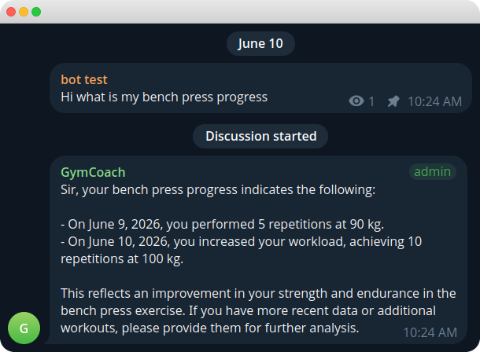
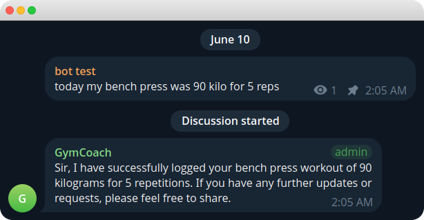
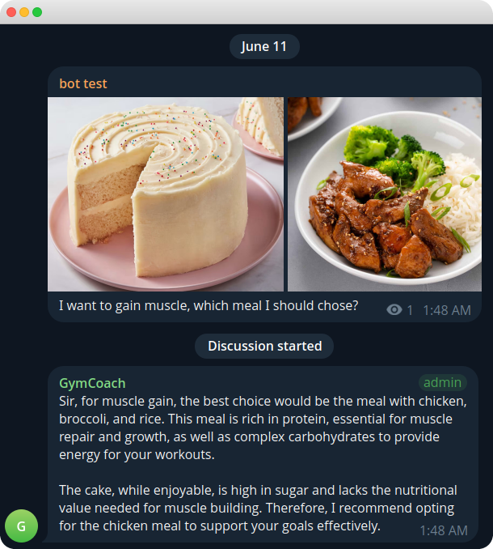
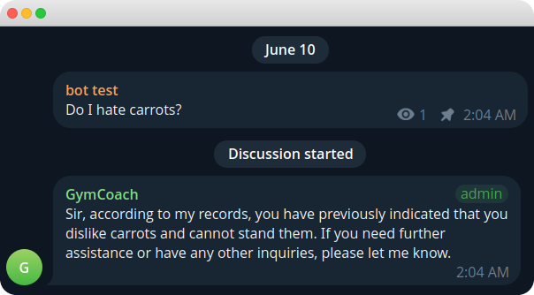

# GymTGBot

A Telegram AI agent for tracking gym progress. It replies in isolated chat threads, remembers long-term facts, stores workout history, and analyzes photos.

<p align="center">
  
</p>

## Features

* Keeps conversations isolated by chat and thread.
* Uses a tool-calling loop and can call multiple tools in a single response.
* Analyzes photos, including meals and physique updates.
* Stores long-term memory, such as injuries, preferences, and recurring issues.
* Tracks workout history, including weights, reps, and progression.
* Manages per-chat CSV tables, such as diet and training plans: create, list, read, update, and delete.

## Architecture

* `handlers/` and `middleware/` — Telegram integration powered by `aiogram`.
* `services/` — business logic and application services.
* `tools/` — LLM tool functions, such as `add_workout`, `query_workout`, `create_table`, and others.
* SQLite — workout tracking and isolated thread memory.
* CSV files — per-chat tables stored in `data/csvs/<chat_id>/` (configurable via `CSV_FOLDER_PATH`).

## Requirements

* Python 3.12+
* [uv](https://docs.astral.sh/uv/)
* Telegram Bot API token
* OpenAI API token

## Telegram Setup

Before running the bot, prepare the Telegram side:

1. Create a Telegram **channel**.
2. Create a **discussion group** and link it to the channel
   (Channel → *Manage Channel* → *Discussion* → add/link a group).
3. Add your bot as an **administrator** of the channel.
4. Add your bot as an **administrator** of the linked discussion group.

This is required because the bot operates inside the channel's discussion
threads, where each topic/thread is kept isolated.

## Access Restriction

The bot reacts only to:

* posts of one channel (they arrive in the linked discussion group);
* messages of one user in that discussion group.

Everything else, including private messages, is ignored silently. Comments
written on behalf of the channel are ignored too.

Messages sent anonymously as the group itself ("Send Anonymously") are
accepted: Telegram hides which admin wrote them, so they cannot be checked by
user. If the group has other admins you do not trust, turn "Remain Anonymous"
off in your admin rights instead and write under your own name.

Set all three variables in `.env`, the bot does not start without them:

```bash
ALLOWED_CHANNEL_ID=-1001234567890  # the channel
ALLOWED_CHAT_ID=-1009876543210     # the linked discussion group
ALLOWED_USER_ID=123456789          # your Telegram user ID
```

To find the IDs, copy the link to any message in the channel or in the group
(`https://t.me/c/1234567890/5`) and put `-100` before the number from the link.
Your user ID and the IDs of public channels and groups, whose links contain a
username instead of a number, can be found with a bot such as @userinfobot or
@getidsbot.

## Installation and Running

```bash
uv sync                      # Install dependencies
cp .env.example .env         # Fill in the required environment variables
```

Then complete the **Telegram Setup** steps above (create the channel,
link a discussion group, and add the bot as an admin to both).

```bash
uv run python -m gym_tg_bot  # Start the application
```

## With Docker

Requires only Docker — no local Python or uv. Still create `.env` and
complete the **Telegram Setup** steps above first.

```bash
cp .env.example .env          # Fill in BOT_TOKEN and OPENAI_API_KEY
docker compose up -d --build  # Build the image and start the bot
docker compose logs -f        # Follow logs
docker compose down           # Stop the bot
```

Application data (the SQLite database, Qdrant storage, and CSV tables) lives in
a named volume mounted at /app/data, so it persists across container restarts
and rebuilds.

## Development

```bash
uv run pytest                               # Run tests
uv run ruff format . && uv run ruff check . # Format and lint
uv run mypy src tests                       # Run type checks
```

## Screenshots

<table>
  <tr>
    <td align="center">
      <br>
      <sub>Logging workouts</sub>
    </td>
    <td align="center">
      <br>
      <sub>Analyzing meal photos</sub>
    </td>
  </tr>
  <tr>
    <td align="center">
      <br>
      <sub>Recalling long-term facts</sub>
    </td>
    <td align="center">
      <br>
      <sub>Tracking workout history</sub>
    </td>
  </tr>
</table>
